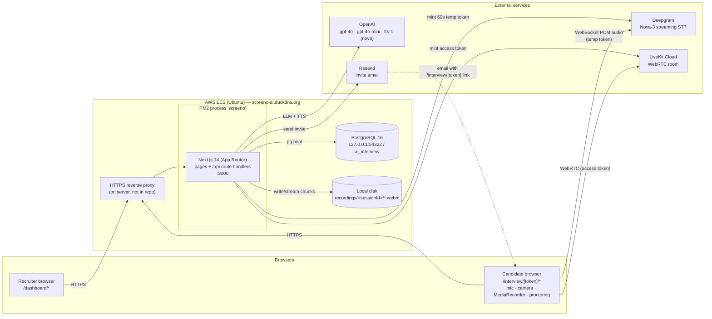
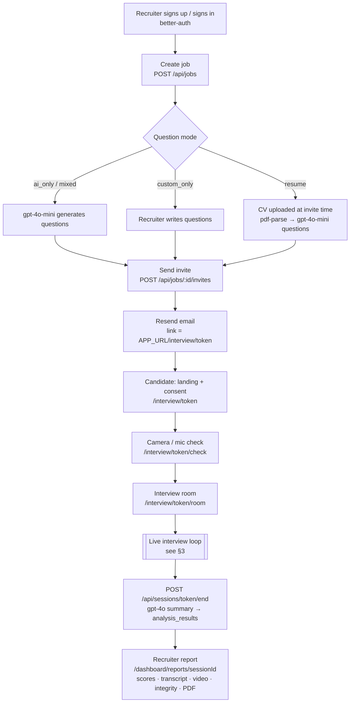
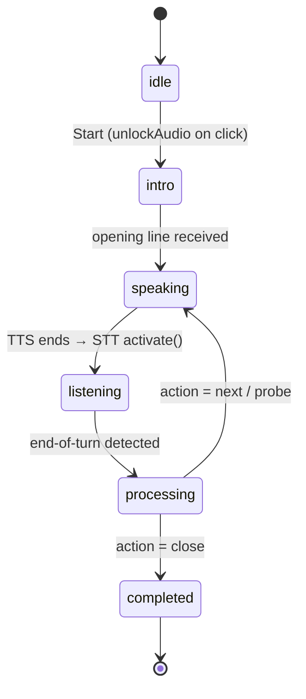
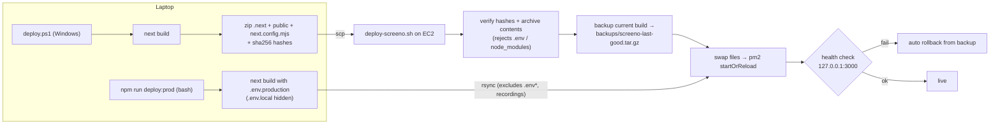

# Screeno — Architecture, Flows, Services & Configuration

> Diagrams use Mermaid. They render on GitHub and in VS Code's Markdown preview (with a Mermaid extension).
> Derived from the code as of 2026-10-22. Where older docs disagree (e.g. AssemblyAI as live STT), the code wins.

---

## 1. System architecture



**Key points**

- One Next.js app serves both UIs and all APIs. There are no separate backend services or workers.
- The browser talks to **Deepgram** and **LiveKit** directly, using short-lived tokens minted by the server. API keys never reach the client.
- Everything else (OpenAI, Resend, DB, recordings) is server-side only.
- Postgres and recordings live **on the same EC2 host** as the app, so back that box up.

---

## 2. End-to-end business flow



Session status: `pending → in_progress → completed`. Links expire after 7 days. The API returns `409` for completed sessions and `410` for expired ones.

---

## 3. Live interview — sequence of one session

```mermaid
sequenceDiagram
    autonumber
    participant C as Candidate browser
    participant API as Next.js API
    participant DB as Postgres
    participant LK as LiveKit Cloud
    participant DG as Deepgram
    participant OAI as OpenAI

    C->>API: POST /api/sessions/{token}/start
    API->>DB: mark in_progress, load job/questions
    C->>API: POST /api/livekit/token
    API-->>C: LiveKit JWT
    C->>LK: room.connect() (camera + mic tracks)
    Note over C: MediaRecorder starts, useProctor starts

    C->>API: POST /turn  {candidate_answer:"__opening__"}
    API->>OAI: gpt-4o-mini opening line
    API-->>C: {action, question}

    loop Until action = "close" (MAX_TURNS = 10)
        C->>API: POST /api/speak {text}
        API->>OAI: tts-1 voice "nova"
        API-->>C: audio/mpeg (MediaSource streaming)
        Note over C: Maya speaks; STT pre-warms
        C->>API: POST /api/deepgram/token
        API->>DG: create temp token (job keyterms)
        API-->>C: token
        C->>DG: WebSocket linear16 16kHz PCM
        DG-->>C: interim/final transcripts, UtteranceEnd
        Note over C: End-of-turn decided client-side<br/>(fallback: Web Speech API)
        C->>API: POST /turn {candidate_answer, turn_index}
        par Brain
            API->>OAI: gpt-4o → {action: next|probe|close, question}
        and Scorer
            API->>OAI: gpt-4o-mini → per-answer score
        end
        API->>DB: transcript_turns, question_scores, turn_metrics
        API-->>C: {action, question, question_id}
    end

    par Background throughout
        C->>API: POST /api/recordings/{id}/chunk (every 5s)
        C->>API: POST /api/sessions/{token}/proctor (on violation)
        C->>API: POST /api/sessions/{token}/telemetry (batched)
    end

    C->>API: POST /api/sessions/{token}/end
    API->>OAI: gpt-4o final summary
    API->>DB: analysis_results, status = completed
```

### Client state machine (`src/hooks/useInterview.ts`)



---

## 4. Services in use — what, where, how configured

| Service | Used for | Called from (code) | Runs where | Config |
|---|---|---|---|---|
| **Next.js 14** | UI + all API routes | `src/app/**` | EC2, PM2 app `screeno`, port 3000 | `next.config.mjs`, `ecosystem.config.cjs` |
| **PostgreSQL 16** | All app data + better-auth tables | `src/lib/db.ts` (`pg` Pool, default max 20) | Prod: on EC2 at `127.0.0.1:54322`. Local: Docker (`docker-compose.local-db.yml`) | `DATABASE_URL`, `DATABASE_POOL_SIZE` |
| **better-auth** | Recruiter email/password auth | `src/lib/auth.ts`, `/api/auth/[...all]`, `middleware.ts` guards `/dashboard/*` | In-app | `BETTER_AUTH_SECRET`, `BETTER_AUTH_URL`, `NEXT_PUBLIC_APP_URL` |
| **OpenAI — gpt-4o** | Interview "brain" (next/probe/close), final summary | `api/sessions/[token]/turn`, `api/sessions/[token]/end` | OpenAI API | `OPENAI_API_KEY` |
| **OpenAI — gpt-4o-mini** | Opening line, per-answer scoring, question generation (job create, regenerate, resume invites) | `turn`, `api/jobs`, `api/jobs/[id]/questions/regenerate`, `api/jobs/[id]/invites` | OpenAI API | `OPENAI_API_KEY` |
| **OpenAI — tts-1 `nova`** | Maya's voice | `api/speak` → `useAudioPlayer` | OpenAI API | `OPENAI_API_KEY` |
| **Deepgram Nova-3** | Live candidate speech-to-text | `api/deepgram/token` (server) → `useSpeechCapture` (browser WS) | Deepgram cloud | `DEEPGRAM_API_KEY`; optional `NEXT_PUBLIC_DEEPGRAM_STT_MODEL`, `NEXT_PUBLIC_DEEPGRAM_STT_LANGUAGE` |
| **Web Speech API** | STT fallback if Deepgram fails | `useSpeechCapture` | Candidate's browser (Chromium) | none |
| **LiveKit Cloud** | WebRTC room for camera/mic tracks | `api/livekit/token` → `useLiveKit` | `wss://ai-interview-qxb8al1x.livekit.cloud` | `LIVEKIT_API_KEY`, `LIVEKIT_API_SECRET`, `NEXT_PUBLIC_LIVEKIT_URL` |
| **MediaRecorder** | Video recording (webm, 5s chunks) | `useVideoRecorder` → `api/recordings/[sessionId]/chunk`, played via `/stream` | Browser → EC2 local disk `recordings/` | none |
| **Resend + React Email** | Candidate invite email | `api/jobs/[id]/invites`, `emails/InviteEmail.tsx` | Resend API | `RESEND_API_KEY`, `RESEND_FROM_EMAIL`, `NEXT_PUBLIC_APP_URL` |
| **pdf-parse** | CV text extraction (resume mode) | `api/jobs/[id]/invites` | In-app | none |
| **@react-pdf/renderer** | Report PDF export | `api/reports/[sessionId]/pdf` | In-app (server-external package) | `next.config.mjs` |
| **Proctoring** | Tab/blur/paste/devtools/fullscreen/face/phone heuristics | `useProctor` → `api/sessions/[token]/proctor` | Browser + DB | none |
| **Telemetry / observability** | Client events, per-turn latency, vendor dashboards | `useSessionTelemetry`, `src/lib/telemetry/*`, `/dashboard/observability`, `/api/metrics`, `/api/cron/telemetry-daily` | In-app + DB | `CRON_SECRET`, `METRICS_SCRAPE_SECRET`, `NEXT_PUBLIC_APP_VERSION` |
| **AssemblyAI** | Voice Lab comparison only (not live) | `api/assemblyai/token`, `/dashboard/voice-test` | AssemblyAI cloud | `ASSEMBLYAI_API_KEY` |
| **DuckDNS** | Public hostname | n/a | `screeno-ai.duckdns.org` → EC2 | DNS |

---

## 5. Configuration reference

### Environment variables

Files are `.env.local` (dev) and `.env.production` (prod build, and the EC2 runtime via PM2). Both are git-ignored and must never be committed.

| Variable | Read by code? | Purpose |
|---|---|---|
| `DATABASE_URL` | ✅ | Postgres connection string |
| `DATABASE_POOL_SIZE` | ✅ (not set → 20) | pg pool max |
| `BETTER_AUTH_SECRET` | ✅ | Auth signing secret |
| `BETTER_AUTH_URL` | ✅ | Auth base URL (prod `https://screeno-ai.duckdns.org`) |
| `NEXT_PUBLIC_APP_URL` | ✅ | Public URL used in invite links + auth client |
| `OPENAI_API_KEY` | ✅ | LLM + TTS |
| `DEEPGRAM_API_KEY` | ✅ | Live STT token minting |
| `LIVEKIT_API_KEY` / `LIVEKIT_API_SECRET` | ✅ | LiveKit JWT minting |
| `NEXT_PUBLIC_LIVEKIT_URL` | ✅ | LiveKit WS URL for the browser |
| `RESEND_API_KEY` / `RESEND_FROM_EMAIL` | ✅ | Invite email |
| `ASSEMBLYAI_API_KEY` | ✅ (Voice Lab only) | |
| `NEXT_PUBLIC_DEEPGRAM_STT_MODEL` / `_LANGUAGE` | ✅ (optional) | Override STT model/language |
| `CRON_SECRET` | ✅ (not set) | Protects `/api/cron/telemetry-daily` |
| `METRICS_SCRAPE_SECRET` | ✅ (not set) | Protects `/api/metrics` |
| `NEXT_PUBLIC_APP_VERSION` | ✅ (not set) | Tags telemetry with release |
| `CV_SCREENING_MODEL` | ✅ (not set → `gpt-4o`) | CV extraction + criterion assessment model (uses `OPENAI_API_KEY`) |
| `CV_CRITERIA_MODEL` | ✅ (not set → `gpt-4o-mini`) | "Suggest criteria from JD" model |
| `CV_STORAGE_DIR` | ✅ (not set → `<cwd>/cv-uploads`) | Private on-disk storage for uploaded CVs (never under `public/`) |
| `CV_MAX_FILE_MB` / `CV_MAX_FILES_PER_BATCH` / `CV_MAX_UPLOADS_PER_DAY` | ✅ (10 / 50 / 300) | Upload limits (enforced server-side) |
| `CV_SCREENING_CONCURRENCY` | ✅ (not set → 2, max 6) | Parallel screenings in the in-process worker |
| `CV_SCREENING_DAILY_BUDGET_USD` | ✅ (not set → 10) | Daily OpenAI spend cap for CV screening (fails closed) |
| `CV_SCREENING_TIMEOUT_MS` | ✅ (not set → 60000) | Per-call OpenAI timeout for screening |
| `CV_DEFAULT_PHONE_COUNTRY` | ✅ (not set → `IN`) | Country assumed for CV phone numbers without a country code |
| `CV_EMAIL_DOH_URL` | ✅ (not set → Cloudflare DoH) | DNS-over-HTTPS fallback for the email-domain check when system DNS is unreachable; `off` disables |
| `DEEPGRAM_PROJECT_ID`, `GLADIA_API_KEY`, `ELEVENLABS_API_KEY`, `ELEVENLABS_VOICE_ID`, `HUGGINGFACE_API_KEY`, `LIVEKIT_URL`, `NEXT_PUBLIC_COMPANY_NAME` | ❌ | Present in env files but not referenced in `src/`. You can remove or rotate them. |

### Config files

| File | What it configures |
|---|---|
| `next.config.mjs` | Marks `@react-pdf/renderer`, `pdf-parse` and `mammoth` as server-external packages |
| `ecosystem.config.cjs` | PM2 app `screeno`; parses `.env.production` into the process env; runs `next start` |
| `middleware.ts` | Redirects unauthenticated `/dashboard/*` requests to `/sign-in` |
| `docker-compose.local-db.yml` | Local Postgres 16 (`postgres/postgres`, db `ai_interview`, port 54322) |
| `db/migrations/000–019` | Schema (applied in order). `supabase/migrations/` is legacy. |
| `scripts/deploy-prod.env(.example)` | Host/user/key for `npm run deploy:prod` (rsync deploy) |
| `.deploy-config.ps1(.example)` | Host/user/key/public URL for `deploy.ps1` (zip deploy) |
| `tailwind.config.ts`, `postcss.config.mjs`, `tsconfig.json`, `.eslintrc.json` | Styling / TS / lint |

### Database tables

- **Auth:** `user`, `session`, `account`, `verification`
- **Core:** `recruiters → jobs → {questions, scoring_rubrics, interview_sessions}`; `interview_sessions → {transcript_turns, question_scores, analysis_results, proctoring_events, question_probe_counts, turn_metrics}`
- **Telemetry:** `session_telemetry_events`, `session_telemetry_summary`, `telemetry_daily_rollup`, `telemetry_release_markers`
- **CV screening (019, see [CV-SCREENING.md](CV-SCREENING.md)):** `jobs → {screening_configs, screening_batches, cv_documents → cv_screenings → screening_decisions}`, `screening_audit_log`, `screening_llm_usage`; `interview_sessions.cv_document_id` (SET NULL on CV delete)

---

## 6. Deployment flow



- The zip path (`deploy.ps1`) refuses to deploy if `package.json` or the lockfile changed, so dependency changes go through `npm run deploy:prod -- --deps`.
- `.env.production` on the server is never overwritten by either path.
- To roll back manually, run `deploy-screeno.sh --rollback` on the EC2 box.
