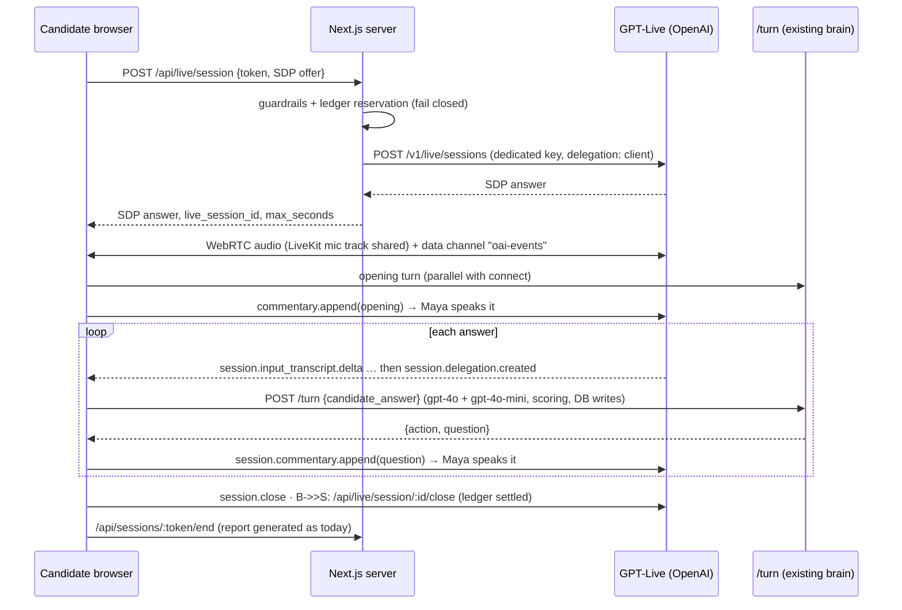

# GPT-Live voice experiment (branch `experiment/gpt-live`)

**Goal:** make Maya feel natural and respond faster by replacing the Deepgram → end-of-turn logic → TTS chain with OpenAI's full-duplex `gpt-live-1` voice model, **without** touching the interview brain, proctoring or recording, and **without** uncontrolled spend on the company account.

Status: implemented, type-checks, guardrails unit-tested against Postgres. **The live provider path has NOT been run end-to-end yet** (it costs money and needs your supervised test). Several provider behaviours are inferred from docs, so follow the test plan below.

---

## 1. How it works



- **Brain unchanged:** question coverage, probe limits, scoring and DB writes still come from `/api/sessions/[token]/turn`. Live only does the audio.
- **Proctoring/recording unchanged:** `useProctor` and `useVideoRecorder` depend only on `interviewState` and the LiveKit tracks, both preserved. The live engine reuses LiveKit's mic track (no second permission prompt).
- **Same interface:** `useLiveInterview` returns exactly what `useInterview` returns; `room/page.tsx` picks the engine.

### Files

| File | Role |
|---|---|
| `src/lib/live/guardrails.ts` | Config, eligibility, atomic spend reservation, ledger close |
| `src/lib/live/instructions.ts` | Voice persona prompt (delegate every turn, never invent questions) |
| `src/app/api/live/session/route.ts` | Mints a session after guardrails pass |
| `src/app/api/live/session/[id]/close/route.ts` | Settles the ledger (also fired on tab close) |
| `src/hooks/useLiveInterview.ts` | Client engine (WebRTC, events, timers, fallback) |
| `src/app/interview/[token]/room/page.tsx` | Engine selection (small diff) |
| `src/app/api/sessions/[token]/start/route.ts` | Adds `live_voice_eligible` to the response |
| `db/migrations/013_live_voice_sessions.sql` | Spend ledger table |
| `db/migrations/014_job_live_voice_flag.sql` | `jobs.live_voice_enabled` per-job toggle |
| `src/app/api/jobs/[id]/route.ts`, `…/jobs/[jobId]/edit/page.tsx` | Toggle API + UI (visible only when the server master switch is on) |

---

## 2. Spend guardrails (company account)

Nothing is on by default. **All** of these must be true before a single paid second starts:

| # | Guardrail | Where |
|---|---|---|
| 1 | `LIVE_VOICE_ENABLED=true` (master kill switch) | server env |
| 2 | **Dedicated key** `OPENAI_LIVE_API_KEY` — never falls back to `OPENAI_API_KEY`, so the pilot lives in its own OpenAI project with its own hard budget | server env |
| 3 | The recruiter turned on **"Use GPT-Live voice"** for the job (job edit page; column `jobs.live_voice_enabled`, default off). `LIVE_VOICE_ALLOWED_JOB_IDS` is an optional env override only. The toggle is hidden unless guardrails 1–2 are satisfied. | DB + server env |
| 4 | Interview session is `in_progress` and unexpired | `/api/live/session` |
| 5 | ≤ `LIVE_VOICE_MAX_CREATES_PER_INTERVIEW` sessions per interview (default 2: one reconnect) | ledger |
| 6 | ≤ `LIVE_VOICE_MAX_CONCURRENT` open sessions (default 2) | ledger |
| 7 | Daily budget `LIVE_VOICE_DAILY_MAX_SECONDS` (default 3600 s = $3.00/day). Unclosed sessions count at their **full** granted duration. | ledger |
| 8 | Per-session hard cap `LIVE_VOICE_MAX_SESSION_SECONDS` (default 900 s = $0.75; absolute ceiling 1800 s). Last session of the day is granted only what's left; < 180 s left = denied. | ledger + client timer |
| 9 | Reservation is atomic (advisory lock) — a burst of candidates can't squeeze past a limit | tested |
| 10 | Any error in the guardrail path **fails closed** → standard engine | tested |

Client-side protection while a session is live:

- Stops at `max_seconds − 20 s` (billable time can't exceed the grant).
- **Idle watchdog:** no audio/transcript activity for 3 min → session closed.
- **Empty-answer guard:** noise never triggers an LLM call; 4 empty turns in a row ends the session.
- Turn ceiling of 16 even if the server never says "close".
- Ledger settled on finish, unmount and `pagehide`; usage is floored at server wall-clock time so a client can't under-report.
- If Live can't start (denied, provider error, or Maya doesn't speak within ~14 s), the room **falls back to the standard Deepgram + TTS engine** automatically. Worst-case wasted spend ≈ 15 s ($0.0125).

Per-link escape hatch: append `?engine=legacy` to any interview URL to force the standard engine.

### Cost math (voice layer: $0.05/min, billed per second, 15 s minimum on WebRTC create)

| Scenario | Voice cost |
|---|---|
| 5-minute test (recommended first run cap) | $0.25 |
| One 12-minute interview | $0.60 |
| Default per-session cap (15 min) | $0.75 |
| Daily default ceiling (60 min) | $3.00 |

Because we use **client delegation**, there is no OpenAI "backend model" charge from Live itself; `/turn` costs the same gpt-4o / gpt-4o-mini calls as today. Deepgram and tts-1 are not used in a live session (small savings). **Real backstop:** set a monthly budget + email alert on the dedicated OpenAI project; the in-app caps are best-effort (see risks).

---

## 3. Configuration

Add to `.env.local` / `.env.production` (never commit them):

```env
LIVE_VOICE_ENABLED=true
OPENAI_LIVE_API_KEY=sk-...                 # key from a SEPARATE OpenAI project with a hard budget
# Per-job opt-in is done in the dashboard (Job → Edit → "Use GPT-Live voice"), no job IDs in env.
# LIVE_VOICE_ALLOWED_JOB_IDS=<uuid,uuid>   # OPTIONAL override list; normally leave unset
# Optional (defaults shown) — tighten for the first run:
LIVE_VOICE_MAX_SESSION_SECONDS=300         # default 900
LIVE_VOICE_DAILY_MAX_SECONDS=900           # default 3600
LIVE_VOICE_MAX_CONCURRENT=1                # default 2
LIVE_VOICE_MAX_CREATES_PER_INTERVIEW=2     # default 2
LIVE_VOICE_VOICE=marin                     # default
```

Apply migrations 013 (ledger) and 014 (per-job toggle): `npm run db:local:migrate` locally; in prod run `psql "$DATABASE_URL" -f db/migrations/013_live_voice_sessions.sql` then `…/014_job_live_voice_flag.sql`. Without 013, live is denied; without 014, the toggle can't be saved and every job reads as "off". Either way, normal interviews and job edits keep working.

**Rollback:** `LIVE_VOICE_ENABLED=false` (restart PM2) — takes effect immediately for new interviews.

---

## 4. Supervised test plan (cheap, in order)

1. **Isolate spend:** create a new OpenAI project (e.g. `screeno-live-pilot`), confirm it has `gpt-live-1` access (not free tier), set a small monthly budget (e.g. $10) with alerts, create the key → `OPENAI_LIVE_API_KEY`.
2. **Local first:** `npm run db:local:migrate`, set the env above with `LIVE_VOICE_MAX_SESSION_SECONDS=300`, create one test job + invite yourself, `npm run dev`, open the interview link, open the debug log panel.
3. **Verify the inferred behaviours** (each shows in the log; the first occurrence of every provider event type is logged as `[LIVE] event: …`):

   | Assumption (inferred from docs) | What you should see | If it fails |
   |---|---|---|
   | Session starts | `Session ready in …ms (cap 300s)` | Falls back to standard engine |
   | `commentary.append` with `delegation_id: null` makes Maya speak the opening | Maya greets within ~1–3 s | Escalates via `instructions.append`; if still silent after ~14 s → fallback |
   | Model delegates after every candidate turn | `event: session.delegation.created` after each answer | Interview stalls → idle watchdog ends it; adjust `instructions.ts` |
   | Input transcript deltas carry usable text | `Candidate: "…"` lines look right (check spacing!) | Words glued together → need to join deltas differently |
   | Spoken question keeps the meaning | Compare what Maya says with the question text in the transcript | Paraphrase drift → tighten instructions or reconsider (docs say Live paraphrases) |
   | Closing | Goodbye spoken, then session ends and report generates | |

4. **Proctoring regression (must all still work while live):** switch tabs, paste, right-click, open DevTools, exit fullscreen, cover the camera ≥ 25 s, hold up a phone screen. Check each event appears in the report; confirm video chunks keep uploading and the recording plays back. Then repeat on `?engine=legacy` to compare.
5. **Compare latency** on the same script: new `live.turn.completed` telemetry (`last_candidate_delta_to_commentary_ms`, `delegation_to_commentary_ms`, `llm_roundtrip_ms`) vs the legacy `llm.turn.completed` (`silence_to_llm_start_ms`, `llm_roundtrip_ms`) plus subjective feel. Check `live_voice_sessions` for actual usage.
6. Only then enable one real job in prod with a small daily cap.

---

## 4b. Tracking whether it's actually improving

Run after each batch of test interviews (local: `Get-Content scripts/live-metrics.sql -Raw | docker exec -i ai-interview-local-postgres psql -U postgres -d ai_interview`; prod: `psql "$DATABASE_URL" -f scripts/live-metrics.sql`). It prints, by engine (live vs legacy):

1. **Headline wait:** candidate stops talking → next question text ready (avg / median / p90 / worst).
2. **Perceived silence** (live): last candidate word → Maya says *anything*, split by `ack` true/false.
3. **Where `/turn` spends time:** brain vs scorer, `scorer_extra_wait`, brain fallbacks, scorer failures.
4. **Outcomes:** avg interview length, answers per interview, early-exit %.
5. **Setup phases:** mic → offer → ICE → create → ready, to find the slow step of the ~4 s connect.
6. **Spend** from the ledger.

**Baseline (first live test, 3 turns):** median 4.0 s, p90 8.9 s, worst 10.2 s — of which `/turn` was 2.8 / 9.7 / 2.6 s. The standard engine adds a fixed 7.2 s silence-commit window before it even calls the LLM.

### Latency improvements added (all measurable with the report above)

| Change | Where | How to A/B |
|---|---|---|
| ~~Client-sent acknowledgement ("Mm-hm.") while `/turn` runs~~ **REMOVED** — it made GPT-Live treat that tiny line as the delegation's *result*, so the real question that followed wasn't spoken (see §4e round 2). The acknowledgement is now voiced by the model itself via `instructions.ts`. | — | Report section 2 still shows how long the candidate sat in silence before hearing any reply |
| **Brain timeout + fallback** — if gpt-4o takes > 7 s (`TURN_BRAIN_TIMEOUT_MS`, `0` disables) the next unasked bank question is used instead of stalling. Scorer bounded at 8 s (`TURN_SCORER_TIMEOUT_MS`); a failed scorer skips that turn's score (never a fake one). | `turn/route.ts` | Force-test: set `TURN_BRAIN_TIMEOUT_MS=1` — every turn should fall back to the next bank question; report section 3 shows `brain_fallbacks` |
| **Shared OpenAI client** (connection reuse) | `turn/route.ts` | Compare `brain_ms` before/after |
| **Nudge safety net** — if Maya doesn't speak the question within 6 s, resend once via instructions | `useLiveInterview.ts` | Event `live.question.nudged` should be rare; frequent nudges mean the two-message pattern is unreliable |
| Per-call timings (`brain_ms`, `scorer_ms`, `scorer_extra_wait_ms`) and setup phases | `turn/route.ts`, `useLiveInterview.ts` | Report sections 3 and 5 |

Also fixed while here: `interview.state_change` was logging 500+ junk `idle→idle` rows per session (unstable telemetry object re-firing an effect), and the "how long will it take" text is now derived from the real question count (landing page + Maya's opening) instead of a hard-coded 15–20 / 10–15 minutes.

**Not done yet (next candidates):** don't make the candidate wait for the scorer; try a faster brain model; skip the LLM for plain "next question" turns; pre-generate the opening line at invite time.

---

## 4c. Finding out what went wrong in a specific interview

**Dashboard → Diagnostics** (sidebar), or the "What happened in this interview?" link on any report.

- **List page:** your last 30 interviews with voice engine, result (finished normally / with hiccups / with serious problems / left early) and issue counts.
- **Detail page:** a plain-English verdict, a list of *what went wrong* (each with a likely cause and "what to do"), and one merged timeline: what our server told Maya to say (purple), **what Maya actually said** (pink, GPT-Live only), what the candidate said, how long people waited (amber), proctor events, and errors (red).
- Everything is derived from data already recorded (transcript, `session_telemetry_events`, proctoring events, spend ledger); the rules live in `src/lib/diagnostics/diagnoseSession.ts` (pure function, easy to extend).

What it detects: goodbye cut off, slow replies (with whether the AI decision or scoring caused it), AI timeouts/fallback questions, unscored answers, empty/uncaptured answers, Maya needing a nudge, voice-provider errors, live→standard fallback, slow start, video drops, interview never finished, early exit, time-cap hit, short question bank, weak answers, and proctoring events.

Interviews recorded before a feature existed have less detail (e.g. no "what Maya actually said" before this change); the goodbye cut-off is still inferred from timestamps.

### Bug fixed: goodbye cut off mid-sentence

Maya's transcript text streams out much faster than her audio plays. The old "no new text for 2.8 s ⇒ she's done" check closed the connection while she was still talking (measured: closed 6.9 s after the goodbye was handed over; a 26-word goodbye needs ~11 s). It now meters Maya's real audio level and closes only after she has been silent for 1.8 s (falling back to a speech-length estimate if the meter can't hear anything), capped at 30 s. The `live.closing.audio` event records how each wait ended.

---

## 4d. Realistic lip-synced avatar (Simli) — "Maya (real)"

A real-person face that lip-syncs to Maya's live voice. **Only works on the GPT-Live engine** (it needs Maya's live audio track); on the standard engine it shows the still photo.

```
GPT-Live audio track ──► Simli (render only, face from your photo) ──► lip-synced video (+ synced audio) in the room
      └─ raw GPT-Live playback is muted ONLY after Simli reports "start" (never a silent moment)
```

- Only **Maya's** synthesized voice goes to Simli. The candidate's audio never does.
- Recruiter picks it at **Dashboard → Avatars → "Maya (real)"** (stored as `recruiters.interviewer_avatar_id = 'real'`).
- Photo asset: `public/avatars/maya-real.webp` (shown as the static/fallback face, cropped to a circle so the corner watermark is outside it). Upload the same photo to Simli to create the face; crop the watermark out of the copy you upload.

### One-time setup (you)
1. Create a Simli account, upload the portrait to create a **face**, copy the **Face ID**, and create an **API key** (use free credits first; confirm current per-minute pricing on Simli's pricing page — third-party sources say ≈ $0.05/min but disagree).
2. In the terminal that runs the app (same window as the `LIVE_VOICE_*` variables), set:
   ```powershell
   $env:SIMLI_ENABLED="true"
   $env:SIMLI_API_KEY="<key>"
   $env:SIMLI_FACE_ID="<face id>"
   $env:SIMLI_MAX_SESSION_SECONDS="300"   # default 900
   $env:SIMLI_DAILY_MAX_SECONDS="600"     # default 1800
   $env:SIMLI_MAX_CONCURRENT="1"          # default 2
   ```
3. Apply migration `015_avatar_sessions.sql` (`npm run db:local:migrate`; prod: `psql "$DATABASE_URL" -f db/migrations/015_avatar_sessions.sql`).
4. Choose "Maya (real)" in Avatars, make sure the job has **Use GPT-Live voice** on, create a new invite, run an interview.

### Guardrails (same philosophy as GPT-Live)
| Guardrail | Detail |
|---|---|
| Master switch | `SIMLI_ENABLED=true` **and** `SIMLI_API_KEY` **and** `SIMLI_FACE_ID` — otherwise nothing is called |
| Only when chosen | The recruiter must have selected the real-person avatar |
| Tied to the voice session | An avatar session can only start while a GPT-Live session is **open** for that interview, and its grant never exceeds that session's remaining time (+30 s) |
| Server-side ledger | `avatar_sessions`: per-interview creates (2), concurrent (2), daily seconds (1800), per-session cap (900, ceiling 1800); unclosed sessions budgeted in full; atomic; fails closed (tested) |
| Provider-enforced cap | The granted seconds are sent to Simli as `maxSessionLength` (+ `maxIdleTime` 180 s), so Simli itself ends the session — independent of our browser code |
| Key safety | The API key never reaches the browser; it only gets a short-lived session token |
| Never lose Maya | Any failure (denied, mint error, startup error, 10 s timeout, mid-session error/stop) → still photo shown **and** raw GPT-Live audio unmuted immediately; no retry loop |

### What to watch in the first test
- **Diagnostics page / metrics report (section 5b):** `avatar.simli.started` (`setup_ms`), `avatar.simli.failed` (reason), `avatar.simli.closed` (billed seconds); section 7 = spend.
- **Opening line:** the avatar needs Maya's audio to exist first, so it connects while she is already greeting; expect the raw voice to switch to the avatar mid-opening (a ≈0.4 s gap is possible). If this bothers you, we can hold the greeting until the avatar is ready (costs latency).
- **Lip-sync delay:** avatar audio runs ≈0.3–0.8 s behind GPT-Live's raw audio; closing waits an extra 1.8 s so the goodbye isn't cut.
- **Interruptions:** when the candidate talks over Maya, GPT-Live stops but the avatar may finish a few buffered words (we stream in real time, so it should be small).

### Not verified (no Simli key was available when this was built)
The Simli connection itself has not been run. Verified: type-check, lint, the spend guardrails against Postgres, and the SDK's real type signatures/token endpoint (`POST https://api.simli.ai/compose/token`, `x-simli-api-key`). Unverified: face creation flow in Simli's dashboard, `livekit` transport reachability on corporate networks, behaviour of `handleSilence:false` with a continuous audio track, and real-world lip-sync/latency quality.

New dependency: `simli-client` (adds `livekit-client`, already used here) → deploy with `npm run deploy:prod -- --deps`.

---

## 4e. Real-interview failures, root causes, fixes — and how to confirm each is fixed

Found in one recorded interview (Frontend Developer, 7.6 min). Run `npm run test:live` any time: it re-checks every rule below against that interview's real text (20 checks, free, < 1 s).

| # | What the candidate saw | Root cause (evidence) | Fix | Confirm on the next run |
|---|---|---|---|---|
| 1 | **"It doesn't move to the next question until I say *that's all*."** | GPT-Live decides on its own when the candidate is finished and waits for explicit closure; every answer in that interview ended "…yeah, that's all". Our own instruction **"be patient with pauses"** reinforced it. There is no turn-detection setting in the API. | (a) Instruction rewritten: a pause after an answer = done. (b) **Our own silence timer**: ≥ 4 s of silence after a real answer (≥ 4 words, Maya quiet, +2.5 s if the answer trails off "…and/um") ends the turn ourselves. Tune with `?turnms=3000`, disable with `?force=off`. Duplicate delegations GPT-Live sends later are resolved silently. | Event `live.turn.forced` appears when you stop talking without "that's all". Metrics §8 shows how long candidates sat silent. If you were cut off mid-thought: `live.turn.force_regret` → raise `?turnms`. |
| 2 | **Maya asked a question that isn't in the bank, repeated it 3×, and the right panel disagreed with her voice.** | GPT-Live is a conversational model: it paraphrases and **improvises** (it invented an accessibility question). While our server was slow (7 s) it filled the silence. Our old "repeat the question" instruction made her repeat. The panel showed our *intended* text, not what she said. | Instructions: speak only when the candidate finished or the backend sent text; stay silent while waiting; never ask anything not provided; repeat once only. A silent hint tells her to keep waiting if our brain takes > 3 s. **Delivery check**: after each question we compare what she *actually said* with what we intended (`deliveryRatio`); if she goes quiet without saying it, we re-send it once through the stronger `instructions` channel. | `live.turn.delivery` events (`ratio`, `delivered`, `nudged`). Metrics §8 `not_asked_as_intended`. Diagnostics shows "Maya didn't ask the intended question" with intended vs spoken. |
| 3 | **Goodbye cut off / never said; panel showed "Thank you…" while she asked a question.** | Same improvisation: she asked an invented question and **never said the goodbye**, yet the interview closed after the audio went quiet. The panel showed the goodbye the moment our server produced it. | The connection now stays open until **(1)** the goodbye's words were really spoken AND **(2)** her audio — and the avatar's, if one is rendering — has been silent. If she doesn't say it, nudge once; bounded at 35 s. The goodbye appears in the panel only after she has said it. | `live.closing.audio`: `delivered: true`, `ended_by: silence`. Diagnostics: no "Maya never said the goodbye". |
| 4 | **Avatar "not stable": cartoon first, sometimes Simli, sometimes the photo.** | (a) The room drew the default **cartoon before `/start` returned** the recruiter's saved choice — code-verified. (b) **Simli ended the session itself after 44 s** of a 300 s grant (ledger: granted 300 s, used 47 s, `provider_stop`), during the candidate's silent answer; afterwards the still photo (a differently-framed face than Simli's render) is shown. The cause of Simli's stop is **not yet known** — Simli's docs don't define its idle rule. | (a) No avatar is drawn until the saved choice is known (neutral placeholder) — cartoon flash gone. (b) Instrumented: on any Simli stop we log the WebSocket close code/reason, Simli's last server messages and what Maya was doing (`avatar.simli.stopped`), and the goodbye now waits for Simli's own `speaking/silent` events. | Metrics §8 "avatar stops" and the Diagnostics page show the evidence. **Also check your Simli dashboard** (plan limits / session logs for that time). If stops happen at a fixed time → plan limit; during the candidate's silent stretches → idle rule (next step would be a keep-alive or per-utterance sessions). |

### Round 2 — a second recorded interview exposed two bugs *I introduced in round 1*

| Symptom | Root cause (from that interview's timeline) | Fix |
|---|---|---|
| **The right panel showed one question while Maya asked the PREVIOUS one** ("You're asking a different question, I think"). Maya was always one question behind; 2 "Maya didn't say the question — nudged" warnings. | (a) The "Mm-hm." I sent as a `commentary.append` was taken by GPT-Live as that delegation's **result**; the real question arrived after the delegation was complete and wasn't spoken. (b) My nudge used `session.instructions.append`, which is **permanent**: each nudge was replayed on the *next* turn, so she repeated the old question. | The real reply is now the **first and only** commentary per delegation. The acknowledgement is voiced by the model (instructions). Nudges are a plain `commentary.append` with no delegation id (the channel that reliably speaks the opening) — never `instructions.append` (opening retry too). Fallback lines ("didn't catch that") are plain speech, not instructions she'd read aloud. Instructions now say: always say the backend reply, even after an acknowledgement. |
| **Panel disagreed with her voice** | The panel updated the moment our server produced the question, whatever Maya was actually saying | Each question appears in the panel once she has started saying it (delivery check), so what's read matches what's heard. |
| **Avatar "goes up, half the face not visible" when the first (long) question appears** | The right panel is a flex column; the real photo is bigger (220 px vs 160 px for cartoons) and the avatar block could *shrink*. When the long first question box appeared the browser squeezed the avatar and the question box covered half the face. | Avatar block is `shrink-0`; question + conversation share one scroll area with the question pinned (sticky) at the top; real avatar 200 px. |
| **Safety gap in the lip-sync avatar** | We mute the raw voice once the avatar is visible, but a face that silently produced no sound would have left the candidate hearing nothing | Watchdog: if Maya has been audibly speaking ≥ 3 s while the avatar's own audio stayed silent, drop the avatar (raw voice returns). Event `avatar.simli.silent_audio`. |

Not reproduced this time: Simli stopping at 44 s (this run the avatar ran 124 s until the interview ended), so that one remains an unexplained one-off; the evidence capture is still in place if it recurs.

### Round 3 — "GPT-Live isn't enabled / no Simli avatar" (it was enabled; one network blip locked it out)

The room showed the standard engine (`Keepalive`, `TTS`, `PCM pre-open flush` log lines) and the still photo. Telemetry showed:

1. 11:32:22 — GPT-Live start failed instantly (`live_session_502 … provider_error`) while Deepgram (WS 1006), Web Speech (`network`) and LiveKit (`reconnecting`) all failed in the same seconds → **the machine's internet dropped**. Our route left that attempt's ledger row **open**.
2. 11:33:15 — the retry was refused: `live_session_429 … concurrency_cap` (the leftover row counted as "a session still running"; the cap was 1), so the room used the standard engine. Simli only runs on GPT-Live, so no avatar.
3. Both master switches were ON throughout and both vendors were reachable afterwards — nothing was misconfigured.

| Flaw (mine) | Fix |
|---|---|
| A fast network failure left the ledger row open for `max_seconds + 60` (6 min) → locked the candidate out of retrying and burned the daily budget (a failed attempt booked a full 300 s) | A fast failure now **releases** the row (records OpenAI's 15 s minimum). A timeout still keeps it open (the session may exist). Same for the avatar route. |
| A retry for the *same interview* was blocked by that interview's own abandoned row | A new attempt for the same interview **supersedes** its own abandoned open row (only if older than 20 s, so a double-click can't orphan a live session). Other interviews' rows are never touched, so the global concurrency cap is intact. Superseded usage is still counted. |
| Failed attempts used up the per-interview allowance (2) | Attempts that never created a real session (`create_failed`, `no_sdp`, `unreachable`) no longer count; real sessions still do. |
| Nobody could tell *why* the room used the standard engine (the live hook's logs vanish on fallback) | The debug-log header now always shows the engine and, if it isn't GPT-Live, a plain-English reason ("couldn't reach OpenAI — check your internet connection", "another GPT-Live session is still counted as open (concurrency cap)", "today's budget is used up", …). |

### Verification protocol (≈ 10 minutes, ≈ $0.40)
1. `npm run test:live` → ALL PASSED.
2. Start the app with the usual variables. Make a new invite; open it.
3. **Turn-taking:** answer a question normally and simply **stop talking — don't say "that's all"**. Expected: Maya moves on ~4–5 s after you stop; Diagnostics shows "answers ended by our silence timer". Then ramble with a long pause mid-answer to see whether you get cut off.
4. **Delivery:** at the last question, say "no idea" / "can you answer it" and stay quiet. Expected: Maya says the real question or a brief neutral line — no new topic. Diagnostics: no "didn't ask the intended question".
5. **Goodbye:** let it finish. Expected: you hear the full goodbye, then it closes; `live.closing.audio` shows `delivered: true`.
6. **Avatar:** no cartoon flash; if Simli stops again, send me the Diagnostics "Avatar was stopped by Simli" entry.
7. `Get-Content scripts/live-metrics.sql -Raw | docker exec -i ai-interview-local-postgres psql -U postgres -d ai_interview` → §8 numbers.

### What this does NOT guarantee
GPT-Live can't be forced to read exact lines (OpenAI: it "is trained to paraphrase"). The prompts reduce improvisation and the delivery check detects and corrects it once, but a strict script can still occasionally drift. The Diagnostics page and metrics §8 now **measure** that rate; if it stays high, the honest options are to accept it, tighten further, or use the standard engine (exact wording, slower).

---

## 5. Known risks / things not verified

- **Not run against the real API yet.** Event names for client delegation come from OpenAI's docs (`session.delegation.created`, `session.commentary.append`, `session.input_transcript.delta`, `session.output_transcript.delta`, `session.usage.updated`, `session.close/closed`). The docs do not document a "final transcript" event, an exact-wording mode, or a maximum session length.
- **Paraphrasing:** OpenAI says Live "is trained to paraphrase" delegated text. Question *meaning* should hold but exact wording may vary from the stored interviewer turn (reports show our text, not Maya's actual words).
- **Transcript quality** for scoring now depends on Live's input transcription (unverified for Indian English). The turn is the unit scored, so check accuracy in step 3.
- **Duration cap is client-enforced.** If a browser crashes without `pagehide`, the provider session may keep billing until its own limit; the ledger budgets such sessions at their full grant, but only the OpenAI project budget truly stops spend. Consider a server-side hangup (OpenAI mentions a hangup endpoint) in a later iteration.
- **No API key for browsers:** Live uses a server-held key with an SDP exchange through our server; the key never reaches the client.
- Mic mute button mutes the shared LiveKit track, so it also silences the candidate to Live (as intended).

---

## 6. Baseline note: legacy latency (independent of Live)

In `src/hooks/useInterview.ts`, `SILENCE_COMMIT_MS = 7_200` and `POST_SPEECH_FINAL_PAD_MS = 4_800` mean the standard engine deliberately waits several seconds of silence before it even calls the LLM ("comfort > latency" per the code comment). By reading the code this alone likely accounts for a large share of the "candidates wait too long" reports, before any model or TTS time. Measure it with the existing `silence_to_llm_start_ms` telemetry — tuning these constants is a free experiment worth running alongside this one.
